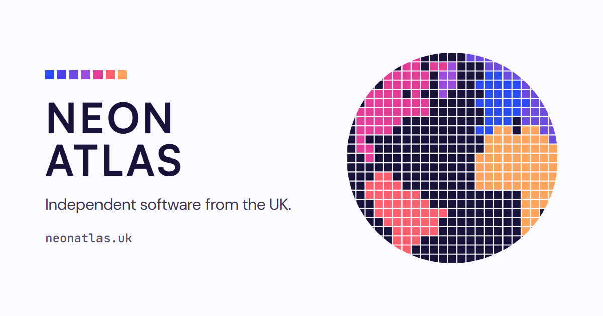
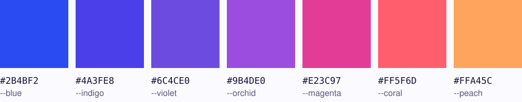

Neon Atlas Ltd is a small, independent software company in the UK. Each product has its own
site, its own design and its own front door, and [neonatlas.uk](https://neonatlas.uk) is where
they are all listed.

## What we make

<table>
  <tr>
    <td width="88"></td>
    <td><strong><a href="https://cabana.today">Cabana</a></strong> A calendar and nested to-do planner in deckchair stripes, on the web, iPhone, iPad and Android.</td>
  </tr>
  <tr>
    <td></td>
    <td><strong><a href="https://tracklim.it">tracklimit</a></strong> An independent Formula 1 live timing and telemetry companion, built on OpenF1 data, in the browser and on Android.</td>
  </tr>
  <tr>
    <td></td>
    <td><strong><a href="https://mintelligence.app">mintelligence</a></strong> A browser tool that adds up a UK online seller's Vinted, eBay, Etsy and PayPal sales for the tax year, box by box for Self Assessment.</td>
  </tr>
  <tr>
    <td></td>
    <td><strong><a href="https://github.com/Neon-Atlas/draw-it-out">draw-it-out</a></strong> A Claude Code plugin that answers questions about your own app from its code, with the file that proves it. Open source under the MIT licence.</td>
  </tr>
</table>

## The mark

The mark is the globe seen over the Atlantic, cut into tiles and clipped to a circle so the
outer tiles keep the curve of the Earth. Each continent is one colour of the spectrum and the
sea is the ink, `#16123A`. The coastlines are real, sampled from Natural Earth's public domain
outlines.

The colours arrive as flat tiles on a light page, never as a gradient or a glow. Type is
Satoshi for display, DM Sans for text and JetBrains Mono for labels and addresses.

## Get in touch

[hello@neonatlas.uk](mailto:hello@neonatlas.uk) reaches a person, for partnerships, press,
bug reports and security reports on any of the products.

Neon Atlas Ltd, registered in England and Wales, company number 17390701. Registered office:
61a Bridge Street, Kington, HR5 3DJ, United Kingdom.
